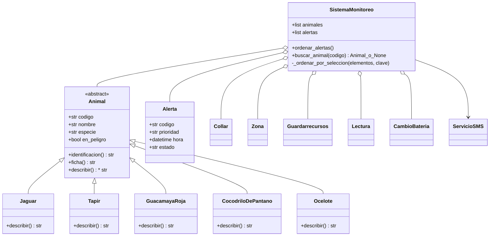

# Guardianes del Petén · Entrega 4

|Dato|Valor|
|-|-|
|Estudiante|Erick Fernando España Ruiz|
|Carné|202201376|
|Grupo|Grupo\_2|
|Fecha|7 de noviembre de 2026|

La Entrega 4 se integra sobre la versión de polimorfismo de la Entrega 3. Conserva las cinco clases de animales y los siete casos de uso del sistema de monitoreo.

## Ejecución

Con Python 3.10 o superior, ejecuta desde la raíz del proyecto:

```bash
python main.py
```

El programa muestra primero el orden de las cinco alertas antes y después de la selección. Luego busca el primer código, el último y uno inexistente. Al final ejecuta el ciclo polimórfico, comprueba el rechazo al instanciar Animal y verifica los siete casos de uso previos.

* **Selección.** En cada pasada se busca el menor par `(nivel, hora)` entre las alertas restantes. Alta vale 1 y media vale 2. Se hace como máximo un intercambio por pasada.
* **Búsqueda binaria.** Se ordenan los animales por código con la misma selección. La búsqueda usa `inicio`, `fin` y `medio` para descartar media lista en cada comparación. Devuelve el objeto encontrado o `None`. La búsqueda es logarítmica sobre la lista ya ordenada. La preparación por selección tiene costo cuadrático y, en esta implementación, se repite en cada llamada.

## Diagrama de clases



## Evidencia de ejecución

La imagen reproduce la salida real de `python main.py` correspondiente a las dos pruebas nuevas. La [salida completa](docs/ejecucion.txt) incluye los casos previos.

!\[Salida de las pruebas de ordenamiento y búsqueda](docs/ejecucion.png)

