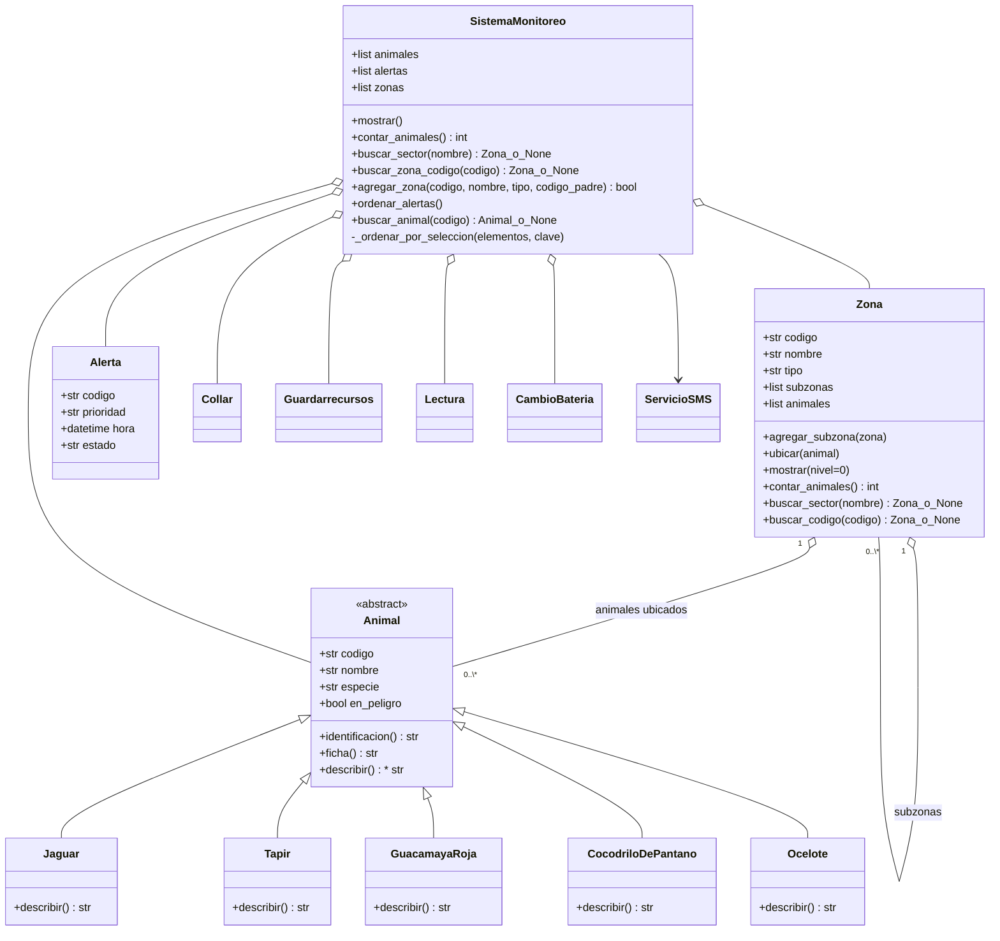

# Guardianes del Petén · Entrega 5

|Dato|Valor|
|-|-|
|Estudiante|Erick Fernando España Ruiz|
|Carné|202201376|
|Grupo|Grupo\_2|
|Fecha|15 de noviembre de 2026|

La Entrega 5 agrega un árbol de zonas sobre el sistema de la Entrega 4. Conserva las cinco especies, la clase abstracta Animal, el polimorfismo, los siete casos de uso, el ordenamiento por selección y la búsqueda binaria.

## Ejecución

Requiere Python 3.10 o superior y no necesita paquetes externos. Desde la carpeta del proyecto:

```bash
python main.py
```

En Linux también puede usarse `python3 main.py`. No ejecutar con `-O`, porque las comprobaciones usan `assert`.

Primero se construye el mapa, se ubican los animales, se muestra el árbol, se cuentan los animales y se hacen las tres búsquedas. Después se ejecutan las comprobaciones de integración y las pruebas de las entregas anteriores.

## Zonas recursivas

`SistemaMonitoreo.zonas` contiene solamente las zonas de primer nivel. Cada `Zona` tiene listas independientes `subzonas` y `animales`, creadas con `default\_factory=list`. No se usa una lista plana para resolver las operaciones recursivas.

* `agregar\_subzona(zona)` y `ubicar(animal)` agregan a sus respectivas listas.
* `mostrar(nivel=0)` imprime dos espacios por nivel y llama a `subzona.mostrar(nivel + 1)`.
* `contar\_animales()` comienza con los animales locales y suma el resultado de cada subzona.
* `buscar\_sector(nombre)` devuelve `self` si coincide; de lo contrario recorre las subzonas recursivamente y devuelve la primera coincidencia o `None`.
* La clase central muestra las raíces, suma sus conteos y consulta sus búsquedas.

Una hoja termina el recorrido porque no tiene subzonas. La búsqueda también termina cuando encuentra el nombre. Si hay nombres repetidos, se devuelve la primera coincidencia en profundidad, según el orden de inserción.

Los tipos siguen siendo `núcleo`, `amortiguamiento` y `uso múltiple`. Sector y aguada son niveles/nombres, no tipos nuevos. `Zona.\_\_post\_init\_\_` valida el tipo incluso en objetos destinados a ser subzonas. La carga mediante `agregar\_zona(..., codigo\_padre=None)` conserva los rechazos anteriores y comprueba el padre y los códigos repetidos. La guarda de zona registrada y los casos GPS/avistamiento ahora encuentran códigos en cualquier nivel mediante `buscar\_codigo()`.

El modelo se usa como un árbol: no agregar una zona dentro de sí misma, ni repetir el mismo objeto bajo varios padres. `ubicar()` solo agrega: la prueba ubica a cada animal una vez; no implementa traslados automáticos ni deduplicación.

## Pruebas y resultados

El mapa tiene siete zonas y tres niveles bajo la reserva: zona → sector → aguada. Cinco animales se reparten en los tres niveles, con Ix en Aguada El Ceibal.

|Prueba|Resultado esperado y comprobado|
|-|-|
|Toda la reserva|5 animales|
|Laguna del Tigre y sus subzonas|4 animales|
|Aguada El Ceibal|1 animal|
|Buscar Aguada El Ceibal (nivel profundo)|Objeto Zona con código Z03|
|Buscar Laguna del Tigre (primer nivel)|Objeto Zona con código Z01|
|Buscar Sector Fantasma|None|

También se comprueban árboles vacíos, hojas, listas independientes, tipo inválido, código repetido, padre inexistente y GPS/avistamiento dentro de una subzona. Las pruebas anteriores comprueban selección, búsqueda binaria, polimorfismo y 22 rechazos de los siete casos de uso.

En la Entrega 4, la selección ordena alertas por prioridad (alta antes que media) y hora. La búsqueda binaria ordena primero los animales por código mediante selección; la búsqueda sobre esa lista es logarítmica y su preparación es cuadrática.

## Diagrama de clases



## Evidencia de ejecución

[Salida completa real de main.py](docs/ejecucion.txt), con las pruebas de las entregas anteriores. La captura muestra la ejecución en terminal de `python3 main.py`, paginada con `more`, con el mapa, conteos y las tres búsquedas.

!\[Captura real de ejecución de la Entrega 5](docs/ejecucion.png)

## Entrega en GitHub

Antes de entregar, completar el grupo en este README, revisar el código y ejecutar `main.py`. El diagrama de clases está incluido arriba en Mermaid y también en [docs/diagrama\_clases.mmd](docs/diagrama_clases.mmd).

Subir los archivos `.py`, este README y la carpeta `docs` al repositorio público del proyecto. El ZIP es un paquete de descarga, no sustituye el enlace del repositorio solicitado por el curso. Comprobar en GitHub que el último commit contiene estos archivos, que la captura se visualiza y que el repositorio abre sin iniciar sesión. Pegar el enlace del repositorio como texto en la tarea.

